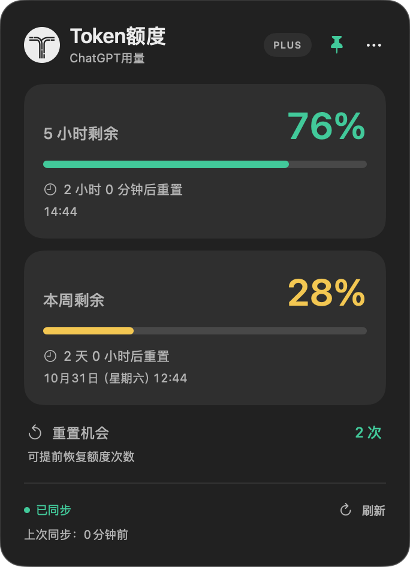
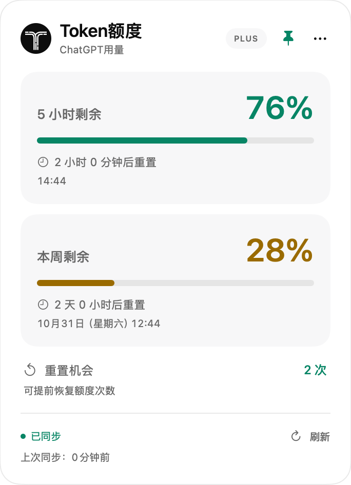

<div align="center">


# Token额度

一个只有中文界面的原生 macOS 额度小工具。

在菜单栏和悬浮卡片中，查看 Codex 接口返回的剩余额度、重置时间与重置机会。

[下载最新版](https://github.com/GirderZ/token-quota-mac/releases/latest) · [让 Agent 帮你安装](docs/AGENT_INSTALL.md) · [反馈问题](https://github.com/GirderZ/token-quota-mac/issues)
</div>

## 它能做什么

- 菜单栏百分比常驻，悬浮胶囊可拖动、记住位置。
- 支持多桌面：在哪个桌面点击，就在哪个桌面展开详情卡片。
- 展示接口返回的 5 小时、本周等额度窗口与重置时间。
- 剩余额度 ≤10% 红色，11–40% 黄色，>40% 绿色；状态栏数字保持系统颜色。
- 每 60 秒同步，也可手动刷新，底部显示距离上次成功同步的分钟数。
- 支持浅色、深色、跟随系统、置顶、登录启动。
- 显示可用重置机会和接口提供的到期时间，**只查看，不自动使用重置机会**。
- 读取实际套餐，显示简短常见类型；复杂或未知类型隐藏，不误标成 PLUS。

目前仅提供**中文界面和中文文档**，没有英文版。

> 这是独立的第三方工具，非 OpenAI 官方产品。卡片副标题为「ChatGPT用量」，实际数据来自 Codex app-server 的额度接口，不能用来查看 ChatGPT 所有聊天模型、图片或文件上传额度。接口和可用窗口可能随账号及服务变化。

## 界面预览

下图使用示例额度、套餐和重置次数，不代表任何人的真实账号。

 

## 使用条件

| 项目 | 要求 |
| --- | --- |
| 系统 | macOS 13 或更新 |
| 预编译版本 | Apple 芯片 Mac（arm64） |
| 登录 | 已安装并登录 Codex CLI，或包含可用 CLI 的 Codex / ChatGPT 桌面应用 |
| 界面语言 | 中文 |
| 额外运行库 | 不需要 Node、Python 或 Rust |

尚未提供 Intel 预编译包。源码的最低目标为 macOS 13；实际桌面验证环境为 Apple Silicon、macOS 27，其他系统组合未全面验证。

## 推荐：把安装交给 Agent

将下面这段话交给能操作本机的 Agent：

```text
请帮我安装 https://github.com/GirderZ/token-quota-mac 。
先阅读 README 和 docs/AGENT_INSTALL.md，检查我的 Mac 是否满足要求，
查看 install.sh 后执行安装。完成后告诉我版本和安装位置。
如果缺少 Codex 登录态或 macOS 要求首次打开确认，请让我手动完成。
```

Agent 会下载安装包、校验 SHA-256 和应用包，再安装到 `~/Applications/Token额度.app`。不需要访问你的 GitHub 私有仓库，也不需要 GitHub Token。

也可以在终端自行执行：

```bash
curl -fL --connect-timeout 15 --max-time 60 https://github.com/GirderZ/token-quota-mac/releases/latest/download/install.sh -o /tmp/token-quota-install.sh && bash /tmp/token-quota-install.sh
```

脚本支持指定版本、安装位置和不立即打开：

```bash
bash /tmp/token-quota-install.sh --version v1.5.2 --no-open
bash /tmp/token-quota-install.sh --destination "$HOME/Applications/Token额度.app"
```

已有旧版时，先退出程序，再加 `--replace` 升级。相同版本会直接复用，不重复覆盖。应用设置保存在系统 UserDefaults 中。

## 手动安装

1. 在 [Releases](https://github.com/GirderZ/token-quota-mac/releases/latest) 下载 `TokenQuotaMac-v版本号-arm64.zip`。
2. 解压，将 `Token额度.app` 放到固定位置，例如用户的 Applications 文件夹。
3. 打开应用，在菜单栏或悬浮胶囊中查看额度。

预编译包采用临时签名，**没有 Apple Developer ID 签名及公证**。首次打开可能需要按 macOS 提示手动确认；安装脚本不会关闭系统安全机制或清除隔离属性。也可按下方步骤从源码构建。

## 操作方式

| 操作 | 效果 |
| --- | --- |
| 悬停胶囊 | 展开详情，移开后收起 |
| 单击胶囊 | 保持展开，再次单击收起 |
| 拖动胶囊 | 调整位置并记住 |
| 双击胶囊 | 恢复默认位置 |
| 滚动胶囊 | 切换系统、浅色、深色外观 |
| 点击菜单栏数字 | 查看详情 |
| 右键胶囊或菜单栏 | 打开设置 |
| 图钉 | 开关置顶 |
| Esc | 收起详情 |
| `…` 菜单 | 外观、悬浮显示、登录启动、退出 |

登录启动只在设置菜单中显示状态。只有系统确认已启用，才显示「已开启」；待批准时会明确提示。

## 几个容易误解的地方

- **百分比是剩余量**，不是已经使用的量。
- **重置机会**是可提前恢复适用额度的一次性机会。次数由官方接口返回，在官方用量设置中使用；本工具不提供兑换按钮。
- **5 小时窗口**的绝对时间采用 24 小时制，跨日显示「明天 HH:mm」；本周窗口保留日期和星期。
- **连接失败**时保留当前会话中的上次读数，标记旧读数。不会用 0% 代替未知数据，也不会把失败当成成功同步。
- **跟随宿主运行**只判断 Codex / ChatGPT 应用是否运行，不跟踪宿主窗口位置、最小化或焦点。

## 从源码构建

需要 Xcode Command Line Tools：

```bash
xcode-select --install
git clone https://github.com/GirderZ/token-quota-mac.git
cd token-quota-mac
./build.sh
```

脚本生成 `Token额度.app`，添加临时签名并运行自检。当前构建目标固定为 arm64，不需要模型 API Key。

```bash
# 运行自检，不连接账号
./Token额度.app/Contents/MacOS/CodexBadge --self-test

# 只读检查真实额度；输出不含账号标识
./Token额度.app/Contents/MacOS/CodexBadge --probe

# 重绘图标
./Tools/build-icon.sh

# 生成发布用 ZIP 和 SHA256SUMS.txt
./Tools/package-release.sh
```

程序自动查找桌面应用内置 CLI、Homebrew 和 PATH。特殊安装可通过 `CODEX_BADGE_CLI` 指定 CLI 的可执行文件。

## 数据与隐私

程序通过本机 `codex app-server --stdio` 只读获取额度；缺少套餐字段时补查账号套餐。不会创建对话、发送模型推理请求或消耗重置机会，不直接读取 `auth.json`，不保存账号标识、令牌或原始协议输出，不上传遥测。app-server 自身会使用既有登录态访问官方服务。

关闭应用时会结束专用 app-server 子进程。源码不包含登录凭据，安装脚本不处理账号登录。不要向 Issue 上传凭据、账号邮箱或原始协议日志。

## 许可与致谢

本项目采用 [MIT 许可](LICENSE)。灵感与额度协议参考 [returnk/codex-usage-badge](https://github.com/returnk/codex-usage-badge)，其 MIT 声明保存在 [THIRD_PARTY_LICENSE.txt](THIRD_PARTY_LICENSE.txt)。这是独立的 Swift / AppKit / SwiftUI 原生实现。

相关资料：[App Server 文档](https://learn.chatgpt.com/docs/app-server) · [重置机会说明](https://help.openai.com/en/articles/20001498-how-resets-work-in-codex)

网络访问失败时，先确认终端可以访问 GitHub。若电脑已配置代理，可给安装进程设置对应的 `HTTPS_PROXY`；不需要修改全局代理或关闭安全设置。Agent 应沿用用户已有的网络设置。
